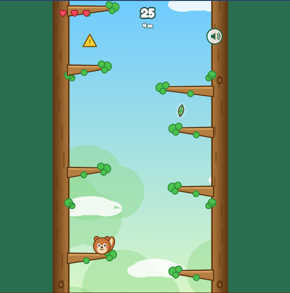
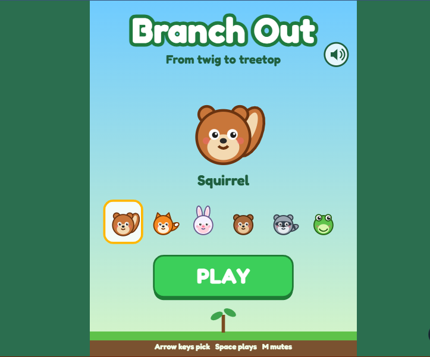
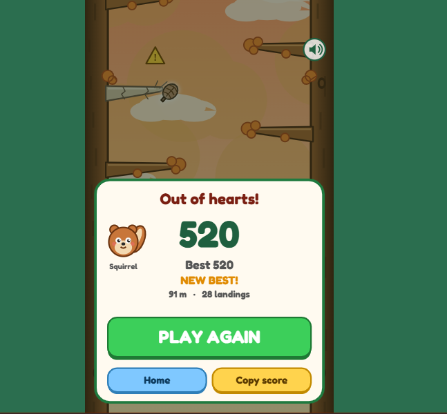

# 🌳 Branch Out

**From twig to treetop.**

An endless climbing arcade game. Pick one of six animals and hop between branches on
two trees while pinecones, twigs and leaves rain down. The higher you climb, the faster
it gets — and the rules start to change.

[](https://branch-out.netlify.app/)
[](LICENSE)
[](#development)

No install. No account. Just branches.



---

## Contents

- [Play](#-play)
- [Controls](#-controls)
- [The rules](#-the-rules)
- [Screenshots](#-screenshots)
- [What makes it interesting](#-what-makes-it-interesting)
- [The climb](#-the-climb)
- [How it works](#-how-it-works)
- [Fairness by construction](#-fairness-by-construction)
- [Development](#-development)
- [Testing and simulations](#-testing-and-simulations)
- [Project structure](#-project-structure)
- [Credits](#-credits)
- [License](#-license)

---

## ▶ Play

**[branch-out.netlify.app](https://branch-out.netlify.app/)**

Open the link and start tapping. Works on phones and desktop, in portrait or landscape,
with no loading screen and nothing to download.

The play area is a single full-height column. On a desktop it sits in the middle of the
screen at a phone-like width; on a phone it fills the screen.

---

## 🎮 Controls

| Action | Touch | Keyboard |
| --- | --- | --- |
| Jump left / right | Tap the left / right half of the screen | `←` `→` or `A` `D` |
| Start a run | **PLAY** | `Space` or `Enter` |
| Play again | **PLAY AGAIN** | `Space` or `Enter` |
| Back to the menu | **Home** | `Esc` or `H` |
| Mute / unmute | Speaker icon, top right | `M` |
| Debug overlay | — | `` ` `` (backtick), or add `?debug` to the URL |

The whole screen is the controller: a tap jumps to the next branch **above on that side**.
Taps made in the last 120 ms of a jump are queued, so quick climbs never drop an input.
While a jump is in the air, new taps wait until you land.

On the start screen, `←` `→` pick an animal and `Space` plays. Buttons swallow stray
taps, so a misplaced tap never starts or restarts a run.

---

## 📜 The rules

- **Three hearts.** A hazard hit costs one heart and 15 points; the score never drops
  below zero. You get about a second of flashing invulnerability afterwards.
- **Land to score.** +10 per landing. Longer jumps are worth more: +5, +10 or +15 on top
  for a medium, long or very long rise. A dry branch pays another +10.
- **Streaks.** Land within 0.9 s of the previous landing to build a streak: 5 in a row
  doubles your points, 10 triples them, 15 or more quadruples them. A hit or a pause
  resets it.
- **Hazards.** Pinecones, twigs and leaves. Every hazard warns first with a marker that
  follows you, then locks in place before it drops.
- **Keep climbing.** The camera rises constantly and speeds up with height. Fall below
  the bottom edge and the run ends.
- **Dry branches** pay more, but crack after you land and snap if you stay. A snap costs
  a heart and drops you; catch a branch on the way down, or tap mid-fall, to save
  yourself.
- **Game over** when all hearts are gone or you fall off the bottom. Restarting is
  instant — no menu round-trip.
- **Personal best** is saved locally in `localStorage`, along with your chosen animal and
  mute setting. A first-ever run shows a ghost-hand tap hint, and the world holds still
  until your first jump.

---

## 🖼 Screenshots

| Starting out | In the canopy | Run over |
| :-: | :-: | :-: |
|  |  |  |
| Six animals, one choice. Cosmetic only — pick who you like. | Hearts, score and height up top; a warning marker shows where not to be. | Score, best, height and landings on one thumb-friendly sheet. |

---

## ✨ What makes it interesting

### 1. The climb changes its rules, not just its numbers

After about 10 m, the generator starts splicing **patterns** into the climb. None of them
are announced; you read the branches.

| Pattern | What it asks of you |
| --- | --- |
| **Free** | Both trees, uneven heights — the classic left/right rhythm. |
| **Zigzag** | Branches alternate between the trees, so **every jump must cross**. Tap the empty side and you stumble for 0.2 s. |
| **Ladder** | Only one tree has branches for a stretch. You can't cross, and hazards leave that lane alone. |

Free stretches separate the patterns, and those free stretches get shorter as difficulty
rises. The generator always leaves a reachable branch, and a seeded simulation proves it.

### 2. Dry branches are a bet

From 20 m, some branches are pale, leafless and cracked. Landing on one pays **+20
instead of +10**, and the streak multiplier still applies — but it starts cracking the
moment you touch it, and snaps 1.0 s later (0.65 s at height).

If you're still standing when it goes, you lose a heart and drop. You can land on a
branch you pass on the same tree, or tap mid-fall to jump to one. A dry branch near the
bottom of the screen is a bad place to linger.

The generator will never force the bet:

- never a dry branch on both trees' next branch at once;
- never a dry branch inside a zigzag or ladder stretch, where the landing branch is the
  only option;
- never two dry branches within one jump's reach of each other.

### 3. Hazards hunt

At the start, hazards fall and you move out of the way. Higher up, **warning markers
track your position** before locking on, so standing still stops being safe. They also
arrive in **waves of two or three** down one tree, and the warning gets shorter as you
climb.

Three kinds fall:

- **Pinecone** — bounces off the trunks, so its path keeps changing.
- **Twig** — falls diagonally.
- **Leaf** — drifts and sways, slower and lazier.

Hitboxes are slightly smaller than the artwork (0.9), and hazards never spawn on you
without a warning.

### 4. It's a climb, not a loop

Five looks blend into each other as you ascend, and each one changes how the game feels.

| Metres | Biome | What changes |
| ---: | --- | --- |
| 0 | **Forest** | Sunshine, green leaves, the basics. |
| 50 | **Autumn** | Warm palette; wind gusts push hazards sideways. |
| 120 | **Mist** | Fog rolls in; hazards fade in late, so you see them closer. |
| 220 | **Storm** | Rain, flashes and stronger wind. |
| 400 | **Summit** | The sun comes up. Confetti, a banner and a fanfare — then the endless climb continues. |

The summit fires once per run, at 400 m. From there the climb carries on in golden light.

---

## 🧠 How it works

A short version: **vanilla JavaScript, ES modules, Canvas 2D.** No framework, no bundler,
no build step, no image files and no audio files. Art is drawn with canvas paths and
sound is synthesized with WebAudio, so the whole game is a handful of text files and a
static host.

- **Fixed timestep.** The simulation advances in 1/60 s steps; rendering happens once per
  animation frame. Long frames (tab switch, breakpoint) are clamped instead of
  fast-forwarding.
- **One coordinate space.** The game plays in 480 logical units wide. The canvas scales
  to the device with a DPR-aware transform (capped at 3×), so phones render sharply.
- **Landscape stays honest.** On a short, wide window the play column narrows instead of
  stretching, so the picture never squashes.
- **World units.** 50 units = 1 metre of height. Y grows upward.
- **Screen-space hazards.** Hazards live in screen coordinates, so their fall speed
  doesn't depend on how fast the camera is climbing. A share of the camera speed is
  added back so they still read as falling when you climb fast.
- **Pooling.** Hazards and particles reuse fixed pools; nothing is allocated per frame in
  the hot path.
- **Forgiving input.** A 120 ms landing buffer, a small stumble instead of a dead tap,
  and rescue taps while falling.
- **Persistence** is wrapped in `try/catch`; private mode or blocked storage just means
  no saved best.

### Files

| File | Role |
| --- | --- |
| `src/main.js` | Boot, canvas sizing, fixed-timestep loop, mute, debug overlay |
| `src/state.js` | Menu → playing → game over state machine |
| `src/input.js` | Pointer taps and keyboard, normalized into actions |
| `src/play.js` | Gameplay orchestration: camera, scoring, hearts, wind, death |
| `src/player.js` | Jump arc, landing, input buffer, stumble, snap-and-fall with rescue |
| `src/world.js` | Endless generator: free / zigzag / ladder stretches, dry branches |
| `src/hazards.js` | Hazard pool, aiming, waves and the fairness rules |
| `src/render.js` | World, HUD, hazards and telegraph markers |
| `src/biomes.js` | Five palettes and the colour blending between them |
| `src/characters.js` | Six animals drawn procedurally |
| `src/fx.js` | Particles, squash and stretch, shake, score pops, confetti |
| `src/audio.js` | Synthesized sound effects and a short loop |
| `src/storage.js` | `localStorage` wrapper for best, animal, mute and hint flag |
| `src/screens.js` | Start screen and game-over sheet |
| `src/ui.js` | Shared buttons and the mute control |
| `src/config.js` | Every tunable number in one place |

---

## ⚖️ Fairness by construction

The game makes promises, and the code enforces them:

- **Every branch is reachable.** The generator spaces branches so a target always exists
  within the jump's maximum rise. A stress test taps thousands of times across free,
  zigzag and ladder stretches and asserts that neither side is ever out of reach.
- **Patterns really are patterns.** Zigzag interiors have no same-side target; ladder
  interiors have no cross-tree target. The test fails if either appears.
- **There is always a healthy choice.** Both trees' next branches are never dry at once,
  and pattern stretches are never dry.
- **Every hazard telegraphs.** No hazard appears on screen without a marker first.
- **Crossing always works.** Two hazards headed for opposite trees never arrive at the
  player's height within 0.9 s of each other, so switching trees is always a real dodge.
- **The only forced tree is protected.** During a ladder stretch, nothing is aimed at
  that tree.
- **The first run is patient.** The world holds still until your first jump, and the tap
  hint appears only once.
- **Bigger jumps are readable.** A longer jump takes longer in the air — the risk is the
  time you've committed, and the reward is the points.

These are verified by seeded simulations rather than by hand, so tuning a number can't
quietly break a guarantee.

---

## 🛠 Development

The game is plain ES modules with no bundler, so it must be served over HTTP. Opening
`index.html` from the filesystem will not work.

```bash
# any static server works
npx serve .
# or
python -m http.server 8000
```

Then open `http://localhost:3000` (or `8000`).

Requirements:

- Any modern browser (pointer events, Canvas 2D, ES modules).
- **Node 18+** only for the command-line tools and simulations.

There is nothing to install: `package.json` has no dependencies. `npm start` runs
`npx serve .`.

Deployment is a static upload. `netlify.toml` sets the publish directory to the repo
root; any static host (Netlify, Vercel, Cloudflare Pages, GitHub Pages) works unchanged.

---

## 🧪 Testing and simulations

The logic is split into DOM-free modules, so most of it runs headless in Node.

| Command | What it checks |
| --- | --- |
| `npm run test:rules` | Scoring, hearts, streak maths, damage, game-over conditions |
| `npm run test:render` | Every screen renders without throwing |
| `npm run test:art` | Six characters and the audio graph build correctly |
| `npm run test:juice` | Particles, shake, score pops, slow motion |
| `node tools/mechanics-test.mjs` | Patterns, dry branches, stumble and mid-fall rescue |
| `npm run sim` | Reachability across free / zigzag / ladder stretches |
| `npm run test:hazards` | Hazard fairness at three difficulty levels |
| `npm run balance` | Bot runs at three skill levels, reporting time, height, score and biomes |

`npm run sim` is the reachability stress test: it plays the real `world.js` and
`player.js` with a bot that taps at human-ish intervals, then asserts that no landing
ever leaves both sides out of reach, that pattern stretches block what they should, and
that dry branches never force a hit.

`npm run test:hazards` spawns tens of thousands of hazards at the start, mid-climb and
maximum difficulty and asserts zero opposite-side conflicts, zero out-of-bounds spawns
and zero hazards appearing on screen without a marker.

`npm run balance` plays the full game state with casual, average and expert bots. It is a
rough guide, not a substitute for a human playtest: bots never panic and never get bored.

Useful debug switches: `?debug` in the URL (or `` ` ``) shows FPS, state and canvas
sizes.

---

## 📁 Project structure

```
BranchOut/
├── index.html                 the whole page
├── style.css                  stage, canvas and page background
├── netlify.toml               static hosting config
├── package.json               scripts and no dependencies
├── src/
│   ├── main.js                boot, resize, loop
│   ├── state.js               state machine
│   ├── input.js               pointer + keyboard
│   ├── screens.js             start screen, game over sheet
│   ├── ui.js                  buttons and mute control
│   ├── play.js                playing state orchestration
│   ├── player.js              jump / land / stumble / fall
│   ├── world.js               endless branch generation
│   ├── hazards.js             hazard spawning and fairness
│   ├── render.js              world, HUD, hazards
│   ├── characters.js          six animals
│   ├── biomes.js              palettes and blending
│   ├── fx.js                  particles and screen feel
│   ├── audio.js               WebAudio synthesis
│   ├── storage.js             localStorage wrapper
│   └── config.js              all tunables
├── tools/
│   ├── rules-test.mjs
│   ├── mechanics-test.mjs
│   ├── render-smoke.mjs
│   ├── art-audio-smoke.mjs
│   ├── juice-test.mjs
│   ├── sim.mjs                reachability stress test
│   ├── hazard-sim.mjs         hazard fairness
│   └── balance-sim.mjs        bot balance report
└── screenshot-*.png
```

---

## 🙌 Credits

- **Design, code and art:** all procedural. Every animal, trunk, branch, hazard and
  particle is drawn with canvas paths; every sound and the music loop are synthesized
  with WebAudio. No third-party sprites, sounds, characters or brands are used.
- **Typeface:** [Fredoka](https://fonts.google.com/specimen/Fredoka), served by Google
  Fonts.
- **Built for:** Twigpine — Project Treetop, Round 01.

---

## 📄 License

[MIT](LICENSE) © 2026 Praise Oga.

Play it, fork it, learn from it, ship your own version. If you do, tell us — we'd love to
see it.
